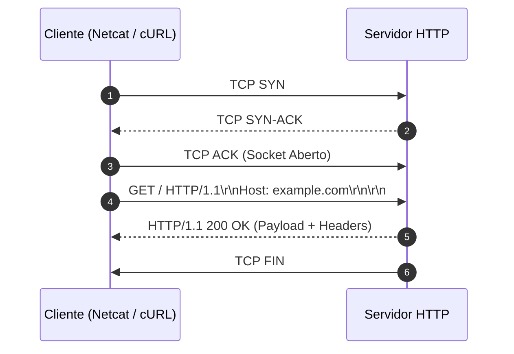

# Memória de Desenvolvimento — Semana 01: Protocolo HTTP & Sockets Bare-Metal
**Aluno:** Karoline Carregal Rangel Chagas  
**Matrícula:** 201821200217  
**Curso:** Bacharelado em Sistemas de Informação  

---

## 1. Mapeamento da Camada de Transporte
Diagrama Mermaid demonstrando o ciclo de vida da requisição executada no laboratório:

Antes de qualquer troca HTTP, cliente e servidor estabelecem a conexão TCP pelo *three-way handshake* (SYN, SYN-ACK, ACK). Só depois disso a requisição HTTP, que é apenas texto ASCII, trafega pelo socket. Ao final, o encerramento é feito com o envio de FIN.

---

## 2. Registro dos Experimentos de Laboratório

### Experimento 1: Netcat Nu & Falha 400 Bad Request
* **Comando Testado:** `nc -C example.com 80` sem o header `Host:`
* **Resultado:** Ao enviar apenas a linha `GET / HTTP/1.1` seguida de uma linha em branco, o servidor respondeu com `HTTP/1.1 400 Bad Request`. No HTTP/1.1 o cabeçalho `Host` é obrigatório porque um mesmo endereço IP pode hospedar vários sites diferentes (*Virtual Hosting*). Sem esse campo, o servidor não tem como saber qual dos domínios hospedados o cliente deseja acessar, então considera a requisição malformada. Ao adicionar `Host: example.com`, a resposta passou a ser `200 OK`. A flag `-C` foi necessária para que o Netcat envie o final de linha no formato CRLF (`\r\n`), exigido pelo protocolo.

### Experimento 2: Semântica dos Métodos HTTP
* **Análise dos Verbos:**
  * **GET** é usado para obter um recurso. Não envia corpo na requisição e os parâmetros, quando existem, vão na URL.
  * **POST** envia dados ao servidor no corpo da requisição, como no envio de um formulário. É usado quando a operação cria ou altera algo no servidor.
  * **OPTIONS** não retorna o recurso em si, apenas informa quais métodos e opções o servidor aceita para aquela URL, geralmente no cabeçalho `Allow`. Também é o método usado pelos navegadores na verificação prévia de CORS (*preflight*).
* **Header Content-Length:** O TCP entrega um fluxo contínuo de bytes, sem marcar onde uma mensagem termina. Por isso, depois de ler os cabeçalhos (que terminam em uma linha vazia `\r\n\r\n`), o servidor usa o `Content-Length` para saber exatamente quantos bytes do corpo deve ler do buffer do socket. Se o valor informado for menor que o corpo real, a mensagem é cortada. Se for maior, o servidor fica aguardando bytes que nunca chegam, até ocorrer *timeout*.

### Experimento 3: URL, Query Strings & Percent-Encoding
* **URL Testada: (Passo 1)** curl -v http://httpbin.org/get?curso=Engenharia da Computacao
* **URL Testada: (Passo 2)** curl -v https://httpbin.org/get?curso=Engenharia%20da%20Computa%C3%A7%C3%A3o
* **O erro no Passo 1:** Como os espaços não estavam codificados, o terminal separou o comando em vários argumentos. O cURL fez a requisição apenas para `http://httpbin.org/get?curso=Engenharia` e tentou tratar `da` e `Computacao` como se fossem outros endereços, retornando erro do tipo `Could not resolve host: da`. Ou seja, o valor do parâmetro chegou incompleto ao servidor.
* **A função do `%20`:** A URL só pode conter um conjunto limitado de caracteres ASCII, e alguns deles têm significado especial (como `?`, `&`, `=` e `/`). Espaços e caracteres acentuados não fazem parte desse conjunto, então precisam ser convertidos para o formato `%XX`, onde `XX` é o valor do byte em hexadecimal. O espaço vira `%20`, e o `ç`, que em UTF-8 ocupa dois bytes, vira `%C3%A7`. No Passo 2 o httpbin decodificou a URL corretamente e devolveu `"curso": "Engenharia da Computação"`.

### Experimento 4: Negociação de Conteúdo & User-Agent
* **Análise:** O cabeçalho `Accept` informa quais formatos o cliente aceita receber (por exemplo `application/json` ou `text/html`), e o servidor escolhe a representação mais adequada entre as que possui. Quando não consegue atender nenhum dos formatos pedidos, pode responder com `406 Not Acceptable`. Já o `User-Agent` identifica o cliente que está fazendo a requisição (navegador, cURL, aplicativo etc.). No httpbin, ao alterar esse cabeçalho com `-H "User-Agent: ..."`, o valor enviado foi devolvido na resposta, mostrando que o servidor lê e pode usar essa informação, por exemplo para entregar uma versão diferente da página para dispositivos móveis.

### Experimento 5: Redirecionamentos & Cache Condicional
* **Redirecionamento (301):** Com `curl -I`, o cURL mostrou apenas os cabeçalhos da primeira resposta, `301 Moved Permanently`, com o novo endereço no cabeçalho `Location`, sem acessá-lo. Com `curl -I -L`, o cURL seguiu automaticamente o endereço indicado e exibiu também os cabeçalhos da resposta final, com `200 OK`.
* **Validação de Cache (304):** Na primeira requisição, o servidor envia junto com o recurso uma `ETag`, que funciona como um identificador da versão daquele conteúdo. Nas requisições seguintes, o cliente envia esse valor no cabeçalho `If-None-Match`. Se o recurso não mudou, o servidor responde `304 Not Modified` sem corpo, e o cliente reutiliza a cópia que já tem em cache. Assim, o conteúdo não é retransmitido, o que economiza banda e reduz o tempo de resposta.

---

## 3. Conclusão Técnica
Os experimentos mostraram que o HTTP é, na prática, texto ASCII trafegando sobre uma conexão TCP, com uma sintaxe rígida. Detalhes como o uso de CRLF no fim de cada linha, a linha em branco que separa cabeçalhos do corpo, a obrigatoriedade do `Host` e o valor correto do `Content-Length` determinam se o servidor consegue interpretar a mensagem. Pequenos erros nesses pontos resultam em respostas como `400 Bad Request` ou em conexões que ficam travadas aguardando dados.

Compreender esse funcionamento em baixo nível é importante para o desenvolvimento de sistemas distribuídos e de alta performance, porque permite diagnosticar problemas que as bibliotecas e frameworks normalmente escondem, além de usar melhor recursos do próprio protocolo, como cache condicional, negociação de conteúdo e redirecionamentos, para reduzir tráfego e latência entre os serviços.

[⬅ Voltar ao Portfólio Central](../index.html)
